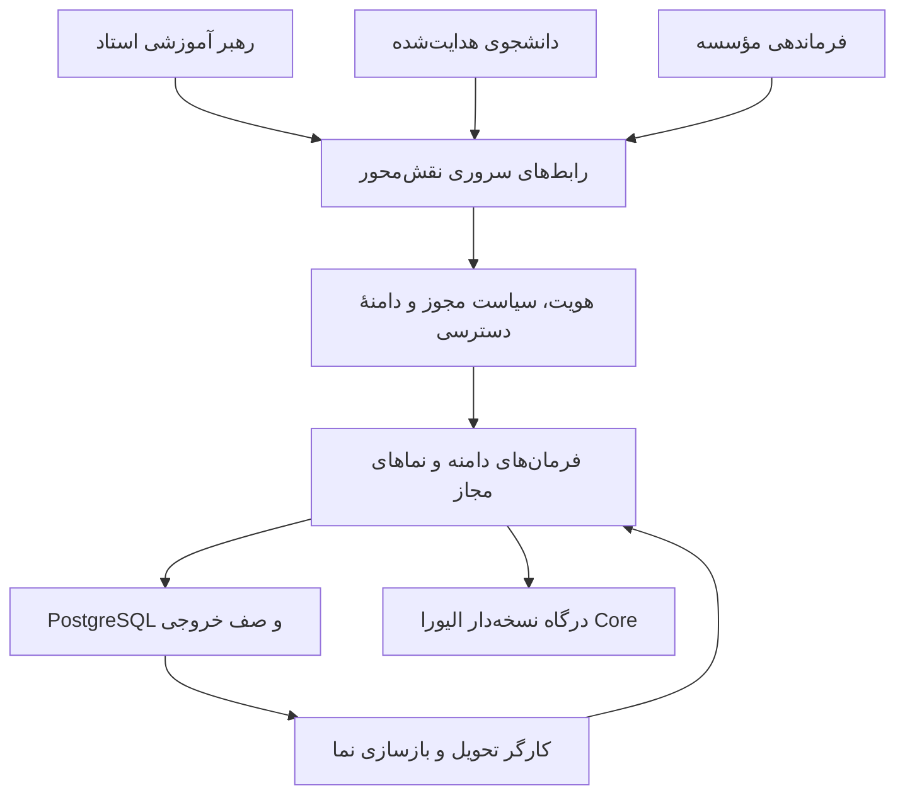

# معماری اجرایی الیورا اینستیتو

| شناسنامه | مقدار |
| --- | --- |
| شناسه | `EI-ARCH-014` |
| وضعیت | پیش‌نویس برای بازبینی |
| تاریخ | ۲۴ نوامبر ۲۰۲۶ |
| مبنای اجرا | شاخهٔ اصلی `ac8401b` و سر زنجیرهٔ باز `be5caef` |
| مبنای حاکمیت | سند مادر و نگاشت مالکیت در درخواست ۱۵ |
| نقطهٔ بازگشت | مبناهای بالا، به‌همراه نقطهٔ بازیابی `EI-CP-20261118-01` |
| تصمیم مرتبط | [ADR-EI-014](../adr/ADR-EI-014.md) |
| وضعیت انتشار | توقف تا احراز دروازه‌های محیط آزمایشی |

## ۱. تجربهٔ محصول و نخستین ارزش قابل تحویل

استاد پس از ورود، دانشجوی تخصیص‌یافته را انتخاب می‌کند و هدف، موضوع، فعالیت و زمان مجاز را تعیین می‌کند. دانشجو فقط این مسیر را در فضای شخصی خود می‌بیند و در همان محدوده در هستهٔ آموزشی الیورا تمرین می‌کند. پس از تمرین، استاد شاهد آموزشی مجاز و اقدام پیشنهادی را می‌بیند. مدیر می‌تواند بفهمد کدام گروه به پیگیری نیاز دارد و آیا اقدام تعیین‌شده نتیجه داشته است. مدیر از نمای سازمانی به دادهٔ خصوصی کوچینگ، یادداشت یا صدای خام دسترسی ندارد.

واحد ارزش پایلوت یک چرخهٔ بستهٔ واقعی است. استاد دامنه را منتشر می‌کند، یک دانشجو تمرین مجاز را تکمیل می‌کند، شواهد مجاز به استاد می‌رسد و استاد ادامهٔ مسیر را تعیین می‌کند. چرخه با یک مؤسسه و یک برنامهٔ آموزشی ارزیابی می‌شود. همین برش باید جداسازی دو مؤسسه را در محیط آزمایشی اثبات کند.

## ۲. توپولوژی و مرزهای ماژول

یک فرایند وب و یک کارگر پس‌زمینه می‌توانند از همان کد و بانک اطلاعاتی PostgreSQL استفاده کنند. رابط سروری هر نقش داده را از ماژول مالک یا نمای مجاز می‌گیرد. دامنه‌ها از طریق رابط کاربردی و رویداد نسخه‌دار به هم وصل می‌شوند. الیورا Core یک سامانهٔ بیرونی با مالکیت مستقل باقی می‌ماند.

| ماژول | مرجع و مسئولیت | محل یا وضعیت اولیه |
| --- | --- | --- |
| هویت و دسترسی | تأیید هویت و نگاشت شناسه، سپس تصمیم مؤسسه بر اساس عضویت، نقش، منبع، هدف و بازه. حساب مالک محصول مسیر و بازبینی اضافه دارد. | سیاست در `src/domain/policy.mjs` و تزریق verifier در زنجیره. پیکربندی واقعی Clerk و رابط سروری باقی است. |
| عملیات مؤسسه | سازمان، شعبه، برنامه، ثبت‌نام، تخصیص، جلسه، حضور و تفویض. | عضویت و تخصیص در زنجیرهٔ PostgreSQL. پیش از طراحی مسیر رسمی جلسه و حضور، مبنای ساخت ۲۳ بازیابی شود. |
| دامنهٔ یادگیری مجاز | استاد تصمیم آموزشی را می‌گیرد. مؤسسه دستور نسخه‌دار، تأیید و لغو را ثبت می‌کند. | سیاست فعلی در `src/domain/learning-scope.mjs` و نسخهٔ زبانی در `src/domain/language-scoped-activity.mjs`. خواندن، تأیید و لغو در زنجیره. ایجاد اولیه هنوز باز است. |
| فضای خصوصی استاد | طرح، بازاندیشی، اقتباس تدریس و کوچینگ محرمانه. | فضای پیش‌نمایش و قواعد نما وجود دارند. نگهداری، رضایت و دسترسی عملیاتی نیازمند قراردادند. |
| دانشجوی هدایت‌شده | نمای شخصی خواندنی، فعالیت مجاز و دعوتِ محدود به تمرین. | خواندن محدود و ترکیب آفلاین در `src/application/` در درخواست‌های ۱۴ و ۱۶. |
| ارزیابی حرفه‌ای استاد | چرخهٔ شواهد، کوچینگ، شبیه‌سازی و تصمیم نهایی انسانی صلاحیت تدریس. مالک نهایی این ماژول در ADR دامنه روشن می‌شود. | هستهٔ صلاحیت در `src/domain/qualification.mjs`. ارزیابی مکالمه‌ای و اتصال به شواهد Core بازند. |
| هوش و مداخله | هوش مالک ریسک، توضیح و برآورد اثر است. مؤسسه مالک تخصیص، فعالیت و وضعیت مداخله است. | قواعد اولیه در `src/domain/intelligence.mjs`. حفظ این تفکیک در API و مدل داده لازم است. |
| هستهٔ آموزشی الیورا | مرجع یادگیری، سنجش آموزشی، تسلط، پیشرفت و وضعیت تطبیقی. | `src/adapters/elyora-port.mjs` اتصال را تا قرارداد رسمی و شواهد محیط آزمایشی بسته نگه می‌دارد. |

ترتیب وابستگی در کد از رابط به کاربرد و از کاربرد به دامنه است. دامنه از HTTP، PostgreSQL و رابط کاربر مستقل می‌ماند. تطبیق‌دهنده‌ها در نقطهٔ راه‌اندازی سرور به رابط‌های کاربردی وصل می‌شوند. SQL هر ماژول در تطبیق‌دهندهٔ همان ماژول متمرکز است. رجیستری ۲۰ موتور باید برای هر موتور، مالک، قرارداد و شاهد همان نسخه را ثبت کند. ماژول‌ها از مسیرهای فعلی به‌تدریج منتقل می‌شوند و نام‌گذاری، به‌تنهایی، دلیل جابه‌جایی فایل نیست.

## ۳. مدل دسترسی و مسیر ثبت دامنه

دامنهٔ دسترسی از هویت تأییدشده، مؤسسه، فضای کاری، نقش مؤثر، منبع و تصمیم جاری استاد ساخته می‌شود. سرور عضویت و تخصیص را از مرجع مؤسسه می‌خواند. نقش یا مؤسسهٔ اظهارشده در مرورگر فقط ورودی مسیریابی است. دسترسی خواندن، ساختن، تأیید، لغو، تمرین و بازبینی به‌صورت جدا سنجیده می‌شوند.

| گام | پیام یا رفتار | شرط پذیرش |
| --- | --- | --- |
| ۱. ایجاد | استاد به کاربر تخصیص‌یافته دامنهٔ پیشنهادی می‌دهد. | قانون برنامه، زبان، گونه، موضوع، فعالیت، بازه و شناسهٔ تکرار امن اعتبارسنجی شوند. مجوز در سرور از وضعیت جاری به دست آید. |
| ۲. ثبت | فرمان با شرط نسخهٔ رکورد و نسل جاری تخصیص ثبت شود. | ایجاد نخستین رکورد و تأیید یا لغو موجود مسیرهای مجزا دارند. تکرار با ورودی یکسان اثر اضافه نداشته باشد و تعارض نسخه قابل تشخیص باشد. |
| ۳. تحویل | ثبت دامنه و رویداد دامنه در یک تراکنش انجام شود. | رویداد به همان مؤسسه محدود باشد. شکست ثبت رویداد هیچ وضعیت جدیدی را قابل مشاهده نکند. |
| ۴. خواندن | دانشجو نمای آموزشی حداقلی خود را دریافت کند. | سرور مجوز و دامنهٔ جاری را دوباره بررسی کند. درخواست پیوند مستقیم، انقضا و تخصیص باطل با همین سیاست سنجیده شوند. |
| ۵. شروع تمرین | تطبیق‌دهنده درخواست نسخه‌دار و حداقلی را به Core بدهد. | قرارداد رسمی باید مالکیت داده، دامنهٔ مجاز، زمان اعتبار، لغو، تکرار و شیوهٔ دریافت شاهد را دقیق مشخص کند. |
| ۶. برگشت شاهد | استاد نتیجهٔ مجاز و منشأ آن را ببیند و اقدام بعدی را ثبت کند. | برآورد و شواهد با نسخهٔ منبع قابل ردیابی باشند. تکمیل تمرین نباید به ثبت تسلط از طرف مؤسسه منجر شود. |

تغییر نسل تخصیص تضمین می‌کند که اعطای دوباره، دامنهٔ قدیمی را احیا نکند. بازگشت عضویت موقت و لغو دائمی تخصیص دو رفتار ثبت‌شده با اثر متفاوت دارند. هنگام انتشار، تصمیم نوع لغو باید در فرمان و آزمون از هم متمایز باشد. مسیر پایدار بازخوانی برای تغییر عضویت، تغییر تخصیص و تغییر دامنه مسئولیت یکسانی دارد. کد فعلی فقط ثبت برخی تغییرهای خود دامنه را به صف متصل می‌کند.

## ۴. رویداد، به‌روزرسانی نما و بازیابی

رکورد دامنه و صف خروجی در یک تراکنش ثبت می‌شوند. کارگر با اجارهٔ کوتاه و توکن اجاره کار می‌کند و پس از شکست، با فاصلهٔ افزایشی دوباره تلاش می‌کند. مصرف‌کننده با کلید مؤسسه و شناسهٔ رویداد اثر تکراری را حذف می‌کند. ترتیب سراسری تحویل تضمین نمی‌شود. هر نمای وابسته به ترتیب باید نسخهٔ منبع خود را رعایت کند و هنگام شکاف از مرجع بخواند.

سیگنال آنی فقط اعلام می‌کند که نما ممکن است عوض شده باشد. بازخوانی سروری پیش از به‌روزرسانی نما انجام می‌شود. برای بازیابی پس از قطع ارتباط، قرارداد باید نشانگر پیشروی وابسته به tenant و نقش جاری داشته باشد. لغو، پیوند مستقیم یا نشانگر قدیمی به‌تنهایی هیچ اختیار دسترسی ایجاد نمی‌کند. در پایان مهلت نگهداری نشانگر، سرور نمای کامل مجاز جاری را از نو تولید می‌کند.

پیش از اتصال عمومی، نرخ خطای ارسال، سن قدیمی‌ترین رویداد، صف شکست‌های نهایی و زمان همگرایی نما ثبت شوند. دادهٔ آموزشی خام یا توکن هویت به لاگ عملیاتی راه پیدا نکند. افزایش عقب‌ماندگی، صف مرده یا شکست بازسازی باید رخداد عملیاتی و دستورالعمل بازیابی داشته باشد.

## ۵. قرارداد و داده

| خانواده | تصمیم طراحی و دروازه |
| --- | --- |
| فرمان و HTTP | نسخهٔ API، شکل ورودی و خروجی، خطای قابل انتظار، شناسهٔ هم‌بستگی و سیاست تکرار مشخص باشند. نمونه‌های JSON Schema، OpenAPI و رفتار اجرا در CI تطبیق داده شوند. |
| رویداد | نام و نسخه، مؤسسه، نویسنده، شناسهٔ منبع، طبقهٔ حریم خصوصی و فیلدهای مجاز برای هر خانواده مشخص باشند. تغییر ناسازگار با نسخهٔ تازه، مبدل یا انتقال هماهنگ عرضه شود. |
| نما و اعلان | فهرست سفید فیلدها برای هر نقش و منظور، رفتار مجازسازی و بازسازی ثبت شود. اعلان تنها اطلاعات لازم برای پیمایش مجاز را حمل کند. |
| Core | نام و نشانی endpoint، شناسه‌های تطبیق، امضای شواهد و زمان‌های اعتبار از مالک Core گرفته شوند. نقل یک طرح‌وارهٔ محلی مجوز اتصال یا ادعای کارکرد ایجاد نمی‌کند. |
| مهاجرت و نگهداری | نقش‌های پایگاه و مجوزهای حداقلی از تعریف نسخه‌دار نصب شوند. تغییر ساختار از الگوی گسترش، انتقال و سپس حذف استفاده کند. پاکسازی، رضایت، نگهداری صوت و دسترسی خانواده نیازمند تصمیم و آزمون جداگانه‌اند. |

پیشنهاد فنی، TypeScript در حالت strict برای مرزهای سروری جدید و بررسی زمان اجرای ورودی‌هاست. هستهٔ فعلی JavaScript و تست‌های آن از مسیر موجود قابل استفاده می‌مانند. قبل از اضافه‌کردن وابستگی جدید، هزینهٔ راه‌اندازی، پوشش تست، اندازهٔ ورودی و اندازه‌گیری مسیر بحرانی ثبت شود.

## ۶. محصول ممتاز و قابل عرضه

| اولویت پیشنهادی | تصمیم محصول | معیار مشاهده در پایلوت |
| --- | --- | --- |
| ارزش برای استاد | صفحهٔ پس از جلسه، شاهد، نقاط ضعف و یک اقدام بعدی قابل انتخاب را کنار هم نشان بدهد. | زمان تصمیم و درصد پیشنهادهایی که استاد با دلیل می‌پذیرد یا اصلاح می‌کند. |
| ارزش برای دانشجو | یک «کار بعدی» با هدف، مدت و بازه روشن. وضعیت انقضا یا لغو به‌روشنی و به زبان خود کاربر. | سهم تمرین‌های مجاز آغازشده، سهم ارجاع‌های مبهم و زمان تا شروع نخستین تمرین. |
| ارزش برای مدیر | صف مداخله با دلیل، اطمینان، مسئول و تاریخ بازبینی. هر اعلان شواهد و امکان بررسی انسانی داشته باشد. | سهم مداخلات به‌موقع با شاهد و نتیجه، نرخ خطای توصیه و مقایسهٔ تمدید در گروه‌های هم‌تراز. |
| زبان و طراحی | مؤلفه‌های مشترک، فاصله و ترتیب خواندن متناسب با RTL و LTR، پیغام خطای کاربردی و جریان‌های کامل با صفحه‌کلید. | بازبینی مسیرهای بحرانی با صفحه‌خوان، صفحه‌کلید و موبایل. برای عرضهٔ هر زبان روبریک، سازگاری صوت و تأیید انسانی همان زبان لازم است. |
| عملکرد | نماهای کوچک با فیلدهای کمینه، صفحه‌بندی، شاخص‌های استعلام سمت tenant و کارگر خارج از مسیر درخواست. | زمان پاسخ صدک ۹۵، خطای درخواست، تأخیر بازخوانی پس از تغییر و هزینهٔ هر تمرین، جدا برای پردیس و سامانهٔ متصل. |
| بستهٔ تجاری | پیشنهاد ورود پایلوت با ارزش بستهٔ CORE برای یک مؤسسه. امکانات GROWTH بعد از سنجش کیفیت توصیه و ماندگاری به پایلوت اضافه شوند. | زمان تا نخستین ارزش، هزینهٔ عملیات هر مؤسسه و سهم زبان‌آموزانی که گردش آموزشی کامل می‌کنند. ماندگاری در کنار کیفیت آموزشی سنجیده شود. |

در پیشنهاد طراحی، چهار فضای گرم پردیس و دارایی‌های دارای منشأ حفظ می‌شوند و نگاشت رنگ‌های رسمی پوستر به توکن‌های کاربردی با آزمون کنتراست مشخص می‌شود. زبان رابط، زبان آموزش و زبان هدف مستقل‌اند. کیفیت آموزش نباید بر اساس تعداد زبان‌های رابط سنجیده شود.

برای مدیر، اثر تجاری و آموزشی جدا گزارش می‌شوند. تمدید و رضایت، فرضیهٔ محصول‌اند. تغییر آنها بدون طراحی اندازه‌گیری و مقایسهٔ مناسب به اثر مستقیم یک ویژگی نسبت داده نمی‌شود. دسترسی آزمایشی بسته‌ها پس از تعریف سیاست دسترسی تجاری، دادهٔ کمینه و معیارهای پایلوت عرضه شود.

## ۷. نقاط عطف و شواهد قابل بازگشت

| نقطهٔ عطف | ترتیب و وابستگی | معیار پایان |
| --- | --- | --- |
| `M01` تثبیت مبنا | سند مادر و واژه‌نامهٔ مالکیت، بازبینی منبع ساخت ۲۳، پیش‌شرط قرارداد Core و قواعد شاخه | شاهد نسخه و مالک هر منبع، حکم اتصال و معیار پذیرش الزام‌آور برای هر سطح تست |
| `M02` برش مستقل مؤسسه | استفاده از زنجیرهٔ ۱۴، ۱۶، ۱۷، ۱۸، ۱۹ و ۲۰ با بررسی تغییرهای بازیابی‌شده | یک استاد دامنه می‌سازد، یک دانشجو می‌خواند و لغو، انقضا، هم‌روندی و بازخوانی عملاً تأیید می‌شوند. اعضای مؤسسهٔ دوم به همان رکورد دسترسی ندارند. |
| `M03` مسیر متصل | تکمیل M02، هویت واقعی در محیط آزمایشی و قرارداد مصوب Core | یک تمرین مجاز و بازگشت شاهد معتبر، رد تمرین خارج از دامنه، بازگشت امن و ثبت نتیجهٔ آزمون بار بر اساس ۳۰۰ دانشجو و ۵۰ استاد |
| `M04` رشد استاد و هوش | مسیر متصل، رضایت صوتی، روبریک تخصصی و دادهٔ مشتق‌شدهٔ نسخه‌دار | ارزیابی جداگانهٔ زبان و تدریس، تصمیم انسانی قابل ردیابی و نخستین مداخلهٔ دارای شاهد و اندازه‌گیری |
| `M05` عرضه و توسعه | رضایت پایلوت و اثبات عملکرد، بررسی گزینهٔ استقرار و دامنهٔ زبان‌های عرضه | معیارهای عملکرد مصوب، مسیر بازگشت، فرایند فعال‌سازی مؤسسه و مرور محصول و مدل تجاری |

هر تحویل با SHA، محیط، نسخهٔ قرارداد و نتیجهٔ آزمون شناخته می‌شود. شاهدها از آفلاین به یکپارچه‌سازی پایگاه، محیط آزمایشی متصل و سپس تولید ارتقا می‌یابند. در بازگشت، ابتدا مسیر فرمان و تحویل درگیر غیرفعال می‌شود و نماها از مرجع جاری بازسازی می‌شوند. برای مهاجرت سازگار، نسخهٔ قبلی برنامه روی شکل گسترش‌یافتهٔ بانک اطلاعاتی آزموده می‌شود. هر مرحلهٔ تأییدشده باید دستورالعمل تکرارپذیر خود را در فهرست [مهارت‌های قابل استفادهٔ مجدد](../audits/AGENTS_SKILLS_REUSE.md) ثبت کند.

## ۸. تصمیم‌های باز

| موضوع | پیش‌نیاز تصمیم یا شاهد |
| --- | --- |
| مالک Core و ساخت ۲۳ | قرارداد رسمی، مسئول نگهداری و شاهد رگرسیون یا تصمیم ثبت‌شدهٔ آرشیوی |
| هویت، اختیار و ورود مالک | اتصال سروری و آزمون کاربر با دسترسی لغوشده، مؤسسهٔ دیگر و بازبینی تازهٔ هویت مالک |
| پذیرش قراردادها و PQE | آزمون قواعد وضعیت، رفتار HTTP، رویداد و محیط یکپارچه‌سازی. پیکربندی موتور کیفیت باید شاهد بررسی لازم و نتیجه را ثبت کند. |
| ارزیابی استاد، خانواده و صوت | دامنهٔ تصمیم انسانی، معیار مستقل هر زبان، قرارداد دسترسی، ثبت رضایت و سیاست نگهداری |
| شیوهٔ استقرار A یا B | مقایسهٔ زمان تا نخستین ارزش، هزینهٔ فرایند ورود، صحت انتقال داده، قابلیت بازگشت و مرجع مالک داده |

[معماری مرجع](REFERENCE_ARCHITECTURE.md) · [نگاشت مرجع حقیقت](SOURCE_OF_TRUTH_MAP.md) · [سند مادر](../governance/MASTER_PROJECT_INSTRUCTION.md) · [نقشهٔ تحویل](../roadmap/BUILD_PLAN.md) · [تحویل ۱۸ نوامبر](https://github.com/hypermindedd/ELYORA-Intelligent-Institute-Operating-System/issues/23)
