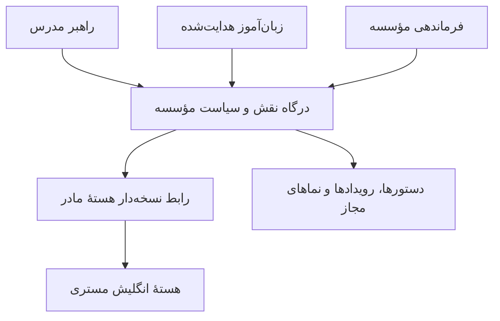

# معماری ماژولار الیورا مؤسسات

نسخهٔ پیشنهادی ۰٫۱ · ۱۷ آبان ۱۴۰۵ · طراحی معماری و یک برش آزمون‌پذیر آفلاین

## مبنا و اعتبار منابع

| منبع | برداشت قابل استناد | حد اعتبار |
|---|---|---|
| [مرجع شاخهٔ راهبر مدرس در نوشن](https://app.notion.com/p/3c9333711317819f84c5f8566020bb06) و [دفتر ثبت](https://app.notion.com/p/3c933371131781a2aca7e1b037a805dc) | مبنای ۰٫۲ و چهار مرجع زیر قفل گزارش شده‌اند. ارزیابی صوت‌محور و غیر بازجویی است. اختیار آموزشی نزد مدرس می‌ماند. | ثبت در ۵ شهریور ۱۴۰۵ با پوشش جزئی. متن مراجع و گفت‌وگوهای جدید باید جداگانه تطبیق داده شود. |
| [شاخهٔ زبان‌آموز هدایت‌شده در نوشن](https://app.notion.com/p/3c933371131781e3afedf7dcb7ee1c59) | اجرا در حدود دستور صریح مدرس با رعایت ایمنی و تسلط هستهٔ مادر. فعال‌سازی به مرجع شاخه، قرارداد و مدل وضعیت پذیرفته‌شده نیاز دارد. | برنامه‌ریزی‌شده |
| [تفکیک شاخه‌ها در مخزن مادر](https://github.com/hypermindedd/Elyora-EnglishMastery/blob/5816b1edd9a061068d0489bc86c34d645423580c/docs/11-TEACHER-STUDENT-BRANCHES-FA.md) | دستور نسخه‌دار، صاحب مجاز، دامنه، زمان، لغو و شواهد اجرا. داده‌های مدرس، مؤسسه و زبان‌آموز جدا هستند. | سند معماری |
| [رجیستری موتورهای مادر](https://github.com/hypermindedd/Elyora-EnglishMastery/blob/5816b1edd9a061068d0489bc86c34d645423580c/docs/03-ENGINE-REGISTRY-FA.md) و [قراردادها](https://github.com/hypermindedd/Elyora-EnglishMastery/blob/5816b1edd9a061068d0489bc86c34d645423580c/contracts/README.md) | مرجع رفتار آموزشی و طبقه‌بندی ۱۵ موتور. قراردادهای منتشرشدهٔ این پوشه پیشنهادی‌اند. | اتصال موتور به محیط مؤسسات نیازمند قرارداد رسمی و شواهد اجراست. |
| [پیشنهاد شراکت مؤسسات](https://chatgpt.com/library?file_id=libfile_8d01a00b88988191b42c3de315e03859&account_id=personal) | تعمیق تمرین در موضوع باز و اختیار مدرس برای باز کردن موضوع بعدی. | پیشنهاد محصول، مؤید جهت طراحی و تابع قواعد قفل‌شده. |
| تصویر پروژه و نسخهٔ فعلی پردیس | تصویر، عنوان پروژه و نام گفت‌وگوها را نشان می‌دهد. نسخهٔ پردیس چهار فضا، ۹ زبان رابط و ۱۱ مسیر نمونه دارد. | تصویر حکم متن کامل منابع را ندارد. پردیس نمایشی است. |

مراجع گزارش‌شدهٔ قفل‌شده

| شناسه | دامنه | دستور پیاده‌سازی |
|---|---|---|
| `02T v0.2` | معماری شاخه | تعیین مالک هر قابلیت و حفظ اختیار مدرس. |
| `02T.P01-A` | هستی‌شناسی وضعیت | مدل خصوصی مدرس و مرز وضعیت‌های شاخه پس از تطبیق متن مبنا پیاده شود. |
| `02T.P01-B` | تشخیص زبان | گفت‌وگوی صوت‌محور، طبیعی و مبتنی بر شواهد. جزئیات سنجه و آستانه از متن قفل‌شده استخراج شود. |
| `02T.P01-C` | تشخیص تدریس | بررسی توان توضیح، اصلاح خطا و انتقال یادگیری. روبریک اجرایی و نسخه باید از منبع قفل‌شده تأیید شود. |
| `02T.P01-D` | راهبری کلاس | تحلیل شیوهٔ تدریس و راهبری با پیشنهاد قابل بررسی. سیاست اقدام و استثنا از منبع قفل‌شده استخراج شود. |

برای تکمیل تطبیق منبع، متن «طراحی معماری انستیتو»، «ادامه پروژهٔ انستیتو»، «ادامه معماری ساخت ۲۴»، «ادامه دیباگ نهایی»، گفت‌وگوی ایجاد معماری راهبر مدرس و فایل‌های زبانهٔ منابع باید بررسی شوند. تاریخ، نسخه، حکم صریح، تعارض و تقدم هر منبع در [ممیزی موجود](../audits/SOURCE_AUDIT_2026-11-07.md) ثبت می‌شود. قواعد مبهم و قراردادهای پیشنهادی تا آن زمان در وضعیت بررسی می‌مانند. سلسله‌مراتب حاکم را [قانون پروژه](../governance/PROJECT_CONSTITUTION.md) و مرجع ثبت شاخه تعیین می‌کنند.

## سه محصول با مرز روشن

| بخش | قابلیت‌های ماژولار | دادهٔ تحت مالکیت | پیوند مجاز |
|---|---|---|---|
| راهبر مدرس | شناخت مدرس، تشخیص زبان و تدریس، راهبری کلاس، برنامهٔ جلسه، ساخت پیش‌نویس تمرین، تأیید دامنه، مشاهدهٔ شواهد، بازبینی | نمایهٔ حرفه‌ای، ترجیحات تدریس، برنامه و یادداشت خصوصی مدرس. دستور تأییدشده در ماژول سیاست مؤسسه نگهداری می‌شود. | تأیید صریح برای دانشجوی منتسب، دستور نسخه‌دار، نمای محدود شواهد دانشجو. |
| زبان‌آموز هدایت‌شده | کابین، فهرست تکلیف مجاز، تمرین داستان‌محور، گفتار و شنیدار، دریافت بازخورد، آرشیو و ادامه از آخرین نقطه | ترجیحات کابین، یادداشت خصوصی و وضعیت اجرای تکلیف در مؤسسه. هستهٔ مادر مالک وضعیت یادگیری و تسلط است. | دستور مدرس دامنهٔ تمرین را تعیین می‌کند. پیشروی به موضوع بعدی نیازمند اجازهٔ صریح مدرس است. |
| فرماندهی مؤسسه | عضویت و ثبت‌نام، انتساب، کلاس و تقویم، اتاق زنده، حضور رسمی، صلاحیت مدرس، مداخله، گزارش و عملیات مالی | ثبت رسمی سازمان و کلاس، وضعیت مداخله و رویدادهای عملیاتی. | انتساب معتبر به ماژول سیاست، نمای تجمیعی به مدیر، ارجاع محدود به شواهد از طریق مجوز سرور. |

هستهٔ مادر مالک درس، سنجش، تسلط و منطق پیشروی آموزشی است. مدرس تعیین می‌کند کدام بخش از برنامهٔ درسی برای دانشجوی مشخص باز باشد. مؤسسه مجوز، زمان و حدود اجرای آن را کنترل می‌کند. داستان و تمرین می‌توانند در موضوع مجاز عمیق شوند، در چارچوب زمان، ایمنی و نسخهٔ برنامهٔ مصوب.

## اتصال و مالکیت موتورهای مشترک

| شناسهٔ مادر | قابلیت قابل استفاده | مرز فراخوانی |
|---|---|---|
| `E02 E05 E06` | هدایت مسیر در موضوع مجاز، تمرین تطبیقی و داستان واقعی | شناسه و نسخهٔ برنامه، موضوع و فعالیت مجاز، زمان باقی‌مانده. خروجی درس و داستان از قرارداد هسته می‌آید. |
| `E03 E04` | شواهد تشخیص زبان و سنجش تسلط | دسترسی مبتنی بر هدف و رضایت. صلاحیت حرفه‌ای مدرس تصمیم جداگانهٔ مؤسسه است. |
| `E01 E07 E08` | تصویر آموزشی، بازیابی دارایی، لحن و پیوستگی | دارایی مجاز و مالکیت مشخص. پوسته و جلوه‌های پردیس در مالکیت مؤسسات‌اند. |
| `E09 E10 E11 E12` | قواعد ایمنی، اجرای نشست، زمینهٔ گفتگو و ابزار | مؤسسه پیش از فراخوانی نقش، رضایت، دامنه و اثر ابزار را بررسی می‌کند. هر قرارداد باید جداگانه تأیید شود. |
| `E13 E14 E15` | الگوی آزمون، ردپا و انتشار | قواعد سازگار و شواهد مستقل برای محیط مؤسسات، بدون انتقال دادهٔ خام. |

درگاه مادر باید به نسخه و قابلیت مشخص محدود باشد. رسید موفق فراخوانی از ثبت پایان تمرین، ارزیابی تسلط یا پیشروی متمایز است. در نبود قرارداد معتبر، اجرای آموزشی بسته می‌ماند. نگاشت شناسهٔ سازمانی به شناسهٔ سرویس مادر فقط سمت سرور و پس از تعیین رضایت و حداقل داده انجام می‌شود.

## ماژول‌های اختصاصی مؤسسات

مالک، مسیرهای مجاز نوشتن و نمودار وابستگی این شناسه‌ها در [رجیستری ماشینی](../../engines/registry.v1.json) نگهداری می‌شوند.

| شناسه | ماژول | کار و پیوند عملیاتی |
|---|---|---|
| `I01` | سیاست و مجوز | هویت از سرور، عضویت و انتساب از مخزن معتبر، بررسی دوباره برای پیوند مستقیم و لغو. |
| `I02` | هماهنگ‌سازی | فرمان‌های نسخه‌دار، جلوگیری از اجرای تکراری، صف خروجی و گردش کار قابل ازسرگیری. |
| `I03` | اتصال مادر | تطبیق نسخه و قابلیت، حداقل داده، مهلت، پاسخ معتبر و توقف امن. |
| `I04` | سازمان و عضویت | مؤسسه، نقش، عضویت، ثبت‌نام و انتساب کلاس. |
| `I05` | دستور مدرس | پیش‌نویس، تأیید و لغو، دامنهٔ مجاز، موضوع‌های منع‌شده و نسخهٔ برنامه. |
| `I06` | تقویم و زمان | زمان‌بندی، منطقهٔ زمانی، انقضا و رزرو بودجهٔ تجمعی تمرین. |
| `I07` | اتاق و حضور زنده | مجوز ورود، توکن کوتاه‌عمر، اتصال دوباره و سیگنال حضور. |
| `I08` | اجرای کلاس | چرخهٔ کلاس و حضور رسمی از مبنای ساخت ۲۳ پس از اثبات محل و نسخهٔ آن. |
| `I09` | کابین‌ها | نمای خصوصی هر نقش، اشتراک هدفمند و تجربهٔ قابل ادامه. |
| `I10` | صلاحیت مدرس | گفت‌وگو و تدریس آزمایشی، شواهد، خطای بحرانی، داور مستقل و امکان اعتراض. |
| `I11` | تطبیق فرهنگی | نگارش، گونهٔ زبان، زمینهٔ فرهنگی، آزمون محلی و بررسی مدرس بومی. |
| `I12` | هوشمندی پیوسته | نشانهٔ مشتق‌شده با منبع، بازه، اطمینان و دلیل قابل توضیح. |
| `I13` | مداخله | پیشنهاد، انتساب، اقدام و پیامد ثبت‌شده با تصمیم انسانی. |
| `I14` | ارتباط انسانی | پیام‌های نقش‌محور و رضایت‌مند، کانال مجاز و سیاست اعلان. |
| `I15` | نیروی آموزشی | اعتبار صلاحیت، تطبیق نقش و حوزهٔ تخصص، پذیرش انسانی. |
| `I16` | درآمد | صورتحساب، تطبیق مالی، بازپرداخت و گزارش حسابرسی. |
| `I17` | کیفیت و شواهد | آزمون مرزی، حریم خصوصی، طراحی، مرورگر، ردپا و دروازهٔ انتشار. |
| `I18` | عامل‌ها و ابزار | فهرست قابلیت، هزینه، حریم داده و تأیید اثر بیرونی. |
| `I19` | تحلیل مدیریتی | نماهای تجمیعی، حداقل اندازهٔ گروه و کنترل اختلاف گروه‌ها. |
| `I20` | کاتالوگ برنامه | برنامه، زبان، گونه، نسخهٔ سرفصل، سطح و وضعیت مجاز انتشار. |

## طراحی، سایت و سرور

- **سایت و جلوه‌ها.** پردیس عمومی و چهار صحنه مسیر نمایشی مستقلی دارند. ناوبری، تایپوگرافی، کارت، دکمه و توکن‌های طراحی بین پوسته‌ها قابل استفاده‌اند. جلوه‌ها با شناسهٔ مستقل، نسخهٔ کم‌تحرک، حالت ساده برای دستگاه ضعیف و آزمون عملکرد و صفحه‌کلید تحویل می‌شوند. دارایی آموزشی تولیدشده از پس‌زمینه و جلوهٔ سایت جداست. [قواعد بصری](VISUAL_REFERENCE_LOCK.md)
- **رابط سه بخش.** هر نقش صفحهٔ ورود، فهرست کار، نمای جزئیات، خطا، دسترسی لغوشده و وضعیت خالی خود را دارد. نمای مدیریت با دادهٔ تجمیعی آغاز می‌شود. زبان رابط، زبان تدریس، زبان هدف و گونهٔ گفتاری مستقل‌اند. فارسی پیش‌فرض رابط است. [قواعد زبان](EIGHT_LANGUAGE_FOUNDATION.md)
- **سرور و داده.** سه درگاه نقش‌محور روی یک هستهٔ ماژولار با مرزهای مجزا ساخته می‌شوند. هر ماژول نویسندهٔ واحد دارد. ثبت تغییر و رویداد خروجی در یک تراکنش انجام می‌شود. مصرف‌کنندهٔ رویداد تکرار را حذف می‌کند و پس از اتصال مجدد نما از وضعیت پایدار بازخوانی می‌شود. برنامهٔ انتخاب پایگاه‌داده، کلیدهای سازمانی، مهاجرت، پشتیبان‌گیری و بازیابی در فاز سرور تأیید می‌شود. [مرز داده](DOMAIN_OWNERSHIP.md)
- **حریم خصوصی.** یادداشت خام، متن گفت‌وگو و صوت مسیر ذخیره و نگه‌داری محدود دارند. مجوز مدیریت، مشاهدهٔ دادهٔ شخصی صادر نمی‌کند. نمایش شواهد به مدرس منتسب وابسته به هدف و دامنهٔ اشتراک است. لغو عضویت و رضایت در جریان فعال نیز بازبینی می‌شود. [ماتریس مجوز](PRIVACY_AUTHZ_MATRIX.md)

## نقشهٔ پیاده‌سازی هر بخش

| بخش | صفحات و اجزای مستقل | فرمان و نمای خروجی | مالک ذخیره و رویداد |
|---|---|---|---|
| راهبر مدرس | آتلیه، نمایهٔ حرفه‌ای، جلسهٔ تشخیص، طراحی جلسه، صندوق شواهد و بازبینی | تهیهٔ پیش‌نویس، تأیید، لغو، بازبینی. نمای پیشرفت فقط برای دانشجوی منتسب و شواهد مجاز. | یادداشت و برنامهٔ شخصی در کابین مدرس. دستور و رویداد تأیید یا لغو در ماژول سیاست. |
| زبان‌آموز هدایت‌شده | کابین، تکالیف باز، تمرین داستان و صوت، بازخورد، آرشیو و ادامهٔ نشست | مشاهدهٔ دستورهای جاری، درخواست آغاز، ثبت انجام تمرین، درخواست بازبینی یا اعتراض. | وضعیت عملیاتی تمرین در مؤسسه. شواهد تسلط، ادامهٔ آموزشی و نتیجهٔ ارزیابی در هستهٔ مادر. |
| فرماندهی مؤسسه | سازمان، نقش‌ها، کلاس، تقویم، اتاق، صلاحیت، مداخله و گزارش | ثبت‌نام و انتساب، زمان‌بندی، صدور مجوز اتاق، داوری انسانی و ثبت پیامد. گزارش قابل ردیابی به شواهد مجاز. | عضویت و انتساب، گردش کلاس، صلاحیت، مداخله و حسابرسی با مالک سازمانی مستقل. |

درگاه آیندهٔ هر نقش، نماهای خواندنی و فرمان‌های نوشتنی جدا دارد. برای نمونه، صفحهٔ بازبینی مدرس وضعیت اجرا و مرجع شواهد را می‌گیرد. فهرست کلاس مدیر از نمای تجمیعی می‌خواند. مرورگر برای انتقال بین صفحه‌ها فقط شناسهٔ منبع را می‌فرستد و هر بار مجوز از سرور دریافت می‌شود.

### گردش ساخت یک قابلیت

1. مسئولیت، منشأ حکم، قرارداد و مالک داده در رجیستری ثبت می‌شوند.
2. حالات رابط شامل بارگذاری، دسترسی لغوشده، خطا، حالت خالی و حالت کم‌تحرک طراحی می‌شوند.
3. فرمان مجاز، مدل داده، زمان‌بندی، راه بازگشت و رویداد در ماژول مالک پیاده می‌شوند.
4. هر مصرف‌کننده نمای محدود خود را با قرارداد نسخه‌دار می‌گیرد.
5. آزمون حداقلی شامل مسیر اصلی، دسترسی ناخواسته، دادهٔ دست‌کاری‌شده، تکرار، قطع سرویس و بازگشت نسخه است.
6. نسخهٔ کد، محیط، گزارش اجرای واقعی و موارد باقی‌مانده در پروندهٔ شواهد ثبت می‌شوند.

### چرخهٔ هوشمندی و ابزارهای بیرونی

چرخهٔ ساخت ۲۴ از مشاهده و توضیح نشانه آغاز می‌شود، پیشنهاد قابل رد به فرد مجاز می‌رسد، پس از انتساب و اقدام انسانی نتیجهٔ قابل سنجش ثبت و دوباره ارزیابی می‌شود. برای هر ابزار بیرونی، فهرست عمل مجاز، حد هزینه، طبقهٔ داده، مهلت و اثر قابل بازگشت یا نیازمند تأیید تعیین می‌شود. هر پیشنهاد باید منبع، دلیل و میزان عدم‌قطعیت داشته باشد.

## نخستین قرارداد اتصال داخلی

برش آفلاین با دامنهٔ مشخص مدرس و مسیر زبان‌آموز آغاز می‌شود. بخش فرماندهی، انتساب معتبر را تأمین می‌کند. قالب دستور نسخهٔ دوم موجود برای این برش به کار می‌رود. تابع آغاز تمرین فقط زمینه‌ای را می‌پذیرد که سرور از نشست، دستور جاری، انتساب جاری و ساعت خودش ساخته باشد. نقش، مجوز، زمان و وضعیت انتساب از بدنهٔ درخواست مرورگر خوانده نمی‌شوند.

| مرحله | ورودی | پاسخ و اثر |
|---|---|---|
| تأیید مدرس | دستور پیشنهادی نسخه‌دار، مدرس منتسب و سیاست مؤسسه | دستور تأییدشده به قلمرو زبان‌آموز مشخص محدود می‌شود. |
| بررسی شروع | دستور جاری، زبان‌آموز، انتساب جاری، زمان سرور و فعالیت | تأیید مدرس باید با صادرکننده بخواند. لغو، انقضا، شناسهٔ نامعتبر یا فعالیت خارج از دامنه، اتصال را متوقف می‌کند. |
| تحویل به درگاه | شناسه و نسخهٔ دستور، نسخهٔ برنامه، موضوع، نوع و مدت فعالیت، زبان و گونهٔ مجاز | تا تأیید قرارداد رسمی، درگاه بسته است. مجاز بودن دامنه به معنای شروع نشست یا موفقیت آموزشی نیست. |
| اتصال پایدار آینده | کلید یکتای فرمان و نسخهٔ جاری دستور در تراکنش | فرمان تکراری همان نتیجه را می‌گیرد، تغییر بدنه با کلید قبلی رد می‌شود، لغو یا تغییر نسخه دوباره ارزیابی می‌شود. رویداد شروع فقط بعد از شروع واقعی ثبت می‌شود. |

خطاهای دامنه قابل تکرار خودکار نیستند. قطع شبکه فقط پس از تطبیق شناسهٔ فرمان و وضعیت اجرای بیرونی مجاز به تلاش دوباره است. بازگشت این برش با حذف مسیر فراخوانی داخلی ممکن است. در نسخهٔ پایدار، لغو و توقف با رویداد جبرانی ثبت می‌شوند. این برش آفلاین هویت و انتساب جاری را از زمینهٔ آزمون می‌گیرد. پیوند پایدار به شناسهٔ کلاس و انتساب برای مواردی که یک مدرس و دانشجو در چند کلاس مشترک‌اند در فاز سرور لازم است. اتصال رسمی هسته و مهاجرت دستورهای نسخهٔ اول قراردادهای جداگانه می‌خواهند.

## ترتیب ساخت و دروازهٔ پذیرش

| فاز | خروجی | دروازهٔ پذیرش |
|---|---|---|
| صفر · آشتی منابع | متن قفل‌ها، دستورهای پروژه، معماری ساخت‌های ۲۳ و ۲۴ و نسخهٔ قراردادهای مادر | منبع، تاریخ، نسخه، تعارض و تصمیم مالک ثبت شده باشد. |
| یک · معماری و قرارداد | مالکیت سه بخش، فهرست موتور، قراردادهای داخلی، مدل تهدید و اولین برش آفلاین | وابستگی یک‌طرفه و آزمون منفی بین مؤسسات، کلاس‌ها، دانشجویان، لغو و انقضا. |
| دو · سرور و پایداری | هویت سرور، انتساب و عضویت، ذخیرهٔ نسخه‌دار، جلوگیری از تکرار، رویداد و آزمون بازیابی | آزمایش واقعی بازیابی، همزمانی، دسترسی مستقیم و بازگشت نسخه در محیط آزمایشی. |
| سه · نخستین مسیر متصل | مدرس دستور دهد، دانشجو با موتور مادر تمرین کند، مدرس شواهد را بازبینی کند و مدیر فقط نمای مجاز ببیند | قرارداد رسمی، اجرای واقعی، کنترل داده و سنجش بدون تغییر قواعد تسلط مادر. |
| چهار · کابین و کلاس | سه کابین خصوصی و اتاق مشترک، نشست رسانه‌ای و احیای اتصال | تأیید مبنای ساخت ۲۳، آزمون خروج و قطع اتصال، تفکیک سیگنال حضور و حضور رسمی. |
| پنج · تشخیص و هوشمندی | تشخیص مدرس، روبریک، شواهد قابل توضیح و چرخهٔ ساخت ۲۴ | تطبیق چهار قفل راهبر، بررسی انسانی و امکان اعتراض، تفکیک پیشنهاد، اقدام و پیامد. |
| شش · عرضهٔ تخصصی زبان | برنامه و گونهٔ زبانی، ارزیابی گفتار و محتوا، بازبین بومی، ظرفیت و آزمون هزینه | پذیرش مستقل هر زبان. شمار مسیرهای نمونه حکم تأیید عرضه نیست. |
| هفت · پایلوت و مهارت‌های تکرارپذیر | پایلوت مؤسسه و بستهٔ شواهد. پس از پایان ساخت، فرایندهای موفق به مهارت‌های قابل استفادهٔ مجدد تبدیل شوند. | سنجش چرخهٔ کامل، پذیرش کیفیت و آزمون مستقل هر مهارت پیش از ثبت. |

برای طراحی سایت از توکن‌ها و الگوهای موجود، برای قراردادها از رجیستری و بررسی ساختاری و برای ارزیابی از موتور کیفیت پروژه و آزمون‌های کاربردی استفاده می‌شود. مهارت‌های اختصاصی آینده فقط از روی فرایندهای اجراشده و قابل تکرار استخراج می‌شوند. نامزدها شامل تحویل اتاق و جلوه، بررسی مجوز میان سه بخش، تطبیق قرارداد هسته و ارزیابی مستقل هر زبان‌اند.
